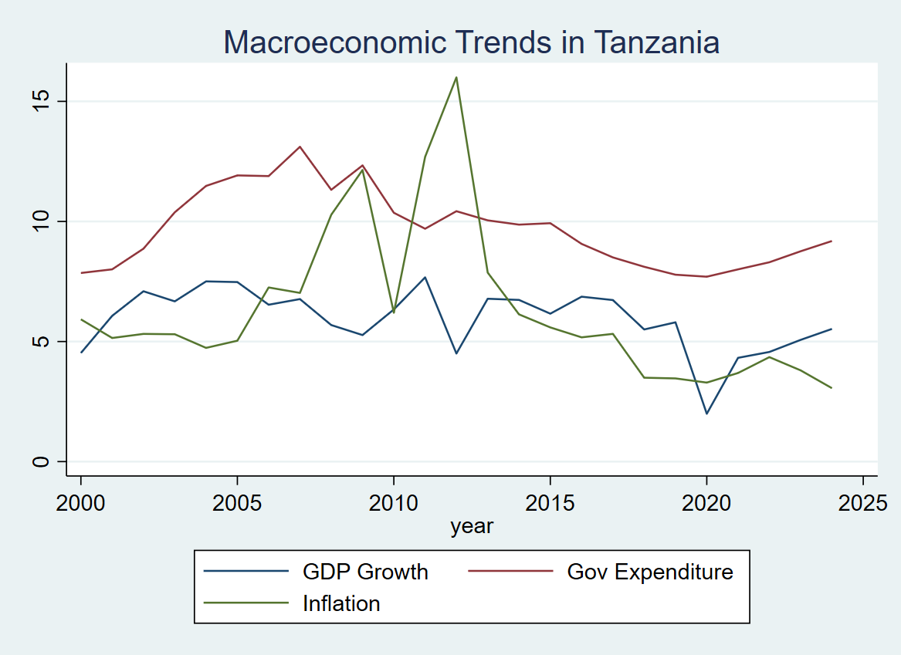

# Tanzania Growth Analysis

**Econometrics · Stata · Macroeconomic time series**

An exploratory study of the relationship between government expenditure, inflation and GDP growth in Tanzania using annual data for 2000–2024.

[View regression results](final_results.txt) · [Read the Stata script](tz%20growth%20analysis.do) · [Source workbook](gdp_inf_and_gexp_tz.xlsx)

## Research question

How are government expenditure and inflation associated with annual GDP growth in this sample?

The baseline specification regresses GDP growth on government expenditure and inflation. The repository identifies the World Bank's World Development Indicators as the data source; the workbook contains the analysis inputs.

## Methods & reported results

The script estimates OLS, OLS with heteroskedasticity-robust standard errors, and a model using lagged expenditure and inflation. It includes heteroskedasticity, autocorrelation, multicollinearity and residual-normality diagnostics.

| Specification | Expenditure coefficient | Standard error | Observations |
|---|---:|---:|---:|
| OLS | 0.437 | 0.172 | 25 |
| Robust OLS | 0.437 | 0.163 | 25 |
| Lagged expenditure | 0.364 | 0.185 | 24 |

These values are transcribed from the committed results table. The first two expenditure estimates meet the table's 5% significance threshold; the lagged estimate meets its 10% threshold. Inflation coefficients are negative and do not meet the table's reported significance thresholds.

## Interpretation

The estimates describe conditional associations. The small observational sample, possible reverse causality, omitted variables and time-series properties prevent a causal interpretation. The lagged specification is a sensitivity check, not proof of robustness across identification strategies.

The current script does **not** implement Newey–West standard errors or stationarity/cointegration testing. These are possible extensions, not completed features.

## Explore the repository

| Artifact | Purpose |
|---|---|
| [Stata do-file](tz%20growth%20analysis.do) | Data preparation, estimation and diagnostics |
| [Excel workbook](gdp_inf_and_gexp_tz.xlsx) | Analysis inputs |
| [Results table](final_results.txt) | Three model specifications |
| [Trend chart](trends.png) | Descriptive visual comparison |
| [Analysis log](analysis.log) | Committed record of an earlier run |

## Replication preparation

Requires Stata and the `estout` package for `eststo` and `esttab`. The script also attempts to install `outreg2`.

1. Download or clone this repository.
2. Open `tz growth analysis.do`.
3. Replace the hard-coded Windows working directory and Excel input path with your local repository and workbook paths.
4. Create the `log/` and `output/` directories **before** running: the script opens the log and exports a graph before its later directory-creation command.
5. Run the script. New logs and graphs use `log/` and `output/`; the results table is written to the repository root.

The committed log and chart are currently at the repository root. The script has not been rerun as part of this documentation review; end-to-end replication still needs verification.

## Author

[Yusuf Abdallah Jongo](https://yusuf-jongo.vercel.app/) — Economist, Data Analyst & AI and Digital Solutions Builder.

